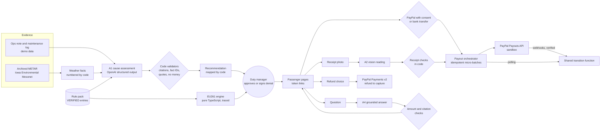

# Groundside

When a flight from an EU airport is cancelled or badly delayed, Groundside checks the airline's stated cause against real archived weather reports, works out what every passenger is owed under EU Regulation 261/2004, and pays them through PayPal once a duty manager approves.

Built for the PayPal AI Hackathon. **Status: in development (Phase 5: hardening and submission).**

- Live demo: https://groundside.onrender.com (free plan: the first request after a quiet spell can take up to a minute while it wakes)
- Try it: open the live demo and press **Start the judge demo**. You get your own copy of a scenario (12 synthetic passengers), signed in as its duty manager, for 24 hours. No login needed.
- Shared demo login and sandbox buyer account for the booking page: to be published here (sandbox only)

## Architecture



The AI recommends; code calculates every amount; only a person can deny compensation.

## What it does

1. Gathers the evidence: the airline's ops note, the maintenance log, and real METAR/TAF weather for the departure airport, the arrival airport and the aircraft's previous flight.
2. An AI model checks whether the stated cause is supported by that evidence. It may cite only verified rules and only weather facts that code extracted. It recommends; it never denies.
3. A deterministic engine computes each passenger's entitlements (compensation, meals, hotel, refund), with every amount traced to a cited rule.
4. Meal allowances can be released before any decision. A duty manager then approves once, or signs a denial with reasons. Meals and hotel are paid either way.
5. Each passenger chooses PayPal (with explicit consent) or bank transfer, and is paid through the PayPal Payouts API.
6. On their personal page, passengers can:
   - send receipts (read by a vision model, checked by code)
   - choose a refund, which goes back to the original PayPal payment
   - ask questions, answered only from their own case file, or ask for a person
7. Unclaimed payouts get reminders and a switch to bank transfer that never pays twice.

## How PayPal is used

- **Payouts API:**
  - micro-batches with an idempotent `sender_batch_id`, for compensation, meal allowances and receipt reimbursements
  - unclaimed handling, including cancellation (the sandbox refuses it with HTTP 500; see `docs/PHASE0_RESULTS.md`)
- **Orders v2 and the PayPal JS SDK:** demo ticket bookings. A paid booking can join the cancelled demo flight as a passenger.
- **Payments v2:** Art 8 refunds to the original capture, tracked by webhook and polling
- Webhooks with signature verification, plus polling reconciliation

All PayPal calls use the **sandbox** only. No real money moves.

## How AI is used

The AI recommends; code calculates; only a human can deny compensation. Model IDs come from environment variables (`OPENAI_MODEL_*`).

- **A1 cause assessment** (`src/lib/ai/a1/`, prompt `prompts/A1.v1.md`): reads the ops note, the maintenance log and numbered weather facts built by code from real archived METARs, and says whether the stated cause is supported. Output is strict JSON. Code then checks it:
  - the schema matches
  - every citation is a verified rule-pack ID
  - every fact ID exists
  - every quote is verbatim
  - no amount of money appears
  - the summary is short

  Code, not the model, maps the result to the shown recommendation. A failed check gets one retry; a second failure shows "uncertain, a human decides". When live AI is unavailable or the daily budget (`AI_DAILY_BUDGET_USD`) is reached, a recorded result is shown with a visible label. Every call is logged with its token count and estimated cost.
- **A2 receipt reading** (`src/lib/ai/a2/`, prompt `prompts/A2.v1.md`): reads a receipt photo into fields with per-field confidence. The photo is resized and stripped of metadata with `sharp` before the AI sees it. Code checks decide, in order:
  1. duplicates across all passengers: same file, or a similar photo with the same amount or time
  2. a repeat claim with the same merchant, total and time
  3. the disruption time window
  4. whether the line items add up to the total
  5. excluded categories and the currency
  6. the remaining allowance
  7. low confidence on any field the decision needs

  Anything doubtful goes to a person in the ops Receipts tab.
- **A4 passenger questions** (`src/lib/ai/a4/`, prompt `prompts/A4.v1.md`): answers only from the passenger's case file, built by code. Code checks that every amount in the answer appears in the case file and that every citation is a verified rule. It always offers a person for legal advice, disputes and requests for a human. "Talk to a person" opens a ticket in the ops Questions tab.
- **A3 notice writer** (`src/lib/ai/a3/`, prompt `prompts/A3.v1.md`): writes one notice per flight and outcome (compensation approved, denied with care, care only) using placeholders only. Code checks:
  - required placeholders are present, and no others
  - no amounts of money appear in the text
  - only verified citations
  - sentences stay short
  - a denial names the national enforcement body

  Code fills the name, amounts, signed reason and link for each passenger. If live AI is off, a code template is used.
- **Evals:**
  - `npm run eval`: A1, 12 cases, report in `docs/EVAL_REPORT.md`
  - `npm run eval:a3`: notices, report in `docs/EVAL_A3.md`
  - `npm run eval:a2`: receipts, report in `docs/EVAL_A2.md`
  - `npm run eval:a4`: questions, report in `docs/EVAL_A4.md`

  All use the live model.
- Weather: Iowa Environmental Mesonet archive (public domain). Archived forecasts (TAF) were not available for the scenario dates, so the demo uses observations only; see `data/weather/SOURCES.md`.

## About the data

`/about-data` lists what is synthetic and what is real, and shows the real weather timelines (AG Charts) for both scenarios.

## Data labels

- Passengers, bookings, the airline ("Demo Air (fictional carrier)") and flight numbers are synthetic and labelled "Demo data" on screen.
- Weather reports are real archived observations, labelled with their source and retrieval time.

## Judge mode

With `JUDGE_MODE=true` (set on the hosted app), the landing page offers **Start the judge demo** (SPEC 14):
- It creates a `JudgeRun` and seeds a private Quick run of scenario A or B.
- It signs the visitor in as a duty manager who can see only that run.
- The judge gets a guide strip and a "Reset this run" control. A demo booking made while signed in joins the judge's own flight.

Guard rails:
- `MAX_JUDGE_RUNS_PER_HOUR` per hashed IP
- runs and their data are removed after 24 hours, when the next run starts
- the daily payout cap (`PAYOUT_DAILY_CAP_EUR`)
- the AI budget (`AI_DAILY_BUDGET_USD`)

## Local setup

Requirements: Node 22 or later, npm, a Neon Postgres database, a PayPal sandbox app.

Windows (PowerShell):

```powershell
git clone https://github.com/Nebiyu-6249/groundside.git
cd groundside
npm install
copy .env.example .env
notepad .env
npx prisma migrate deploy
npm run dev
```

macOS / Linux:

```bash
git clone https://github.com/Nebiyu-6249/groundside.git
cd groundside
npm install
cp .env.example .env   # then edit .env
npx prisma migrate deploy
npm run dev
```

Open http://localhost:3000. `GET /api/health` reports database status.

Every variable is documented in [`.env.example`](.env.example).

### PayPal sandbox setup

In the PayPal developer dashboard (sandbox):

1. Create a **Business** account in Germany and keep the email PayPal generates (`sb-...@business.example.com`). Give it a EUR balance. A business account created with a custom email declined every checkout in our tests ("rejected due to international regulations"); see [`docs/PHASE0_RESULTS.md`](docs/PHASE0_RESULTS.md).
2. Create a REST app linked to that business account, with Payouts enabled. Put its client ID and secret in `.env`.
3. Create Personal accounts in Germany with generated emails for the passenger pool and the ticket buyer. List the pool in `PAYPAL_POOL_RECEIVERS`.
4. For webhooks, expose the dev server (for example `cloudflared tunnel --url http://localhost:3000`), add a webhook for all events at `<public URL>/api/webhooks/paypal`, and put its ID in `PAYPAL_WEBHOOK_ID`.

Test the checkout in a regular browser (Chrome, Edge, Firefox); embedded browser panes can break the PayPal window.

### Ops console

1. `npm run reset-demo` seeds scenarios A and B and the demo duty manager.
2. Sign in at `/login`. Without `DEMO_OPS_PASSWORD` in `.env`, the seed writes a generated local password to `scripts/out/demo-credentials.txt`.
3. Open a disruption. A full run goes like this:
   1. Read the evidence.
   2. Run the AI assessment.
   3. Approve, or sign a denial.
   4. Simulate passenger responses. PayPal sandbox payouts start at once.
   5. Open any passenger from the Passengers tab.

`npm run e2e -- --scenario=A` runs the same path from the command line against the sandbox.

### Deploy (Render)

`render.yaml` is a Render Blueprint: one Node web service in Frankfurt on the free plan.
- **Build:** `npm ci --include=dev && npx prisma migrate deploy && npm run build`
- **Start:** `npm start`
- **Health check:** `/api/health`

`npm run deploy:render` deploys with the Render CLI (`winget install Render.CLI`, then `render login` once) and the values in `.env`. It does four things:
- creates a separate hosted database on Neon, then migrates and seeds it
- creates the Render service, or redeploys it
- points a PayPal sandbox webhook at it
- waits until the service is live

Step by step: [`docs/DEPLOY.md`](docs/DEPLOY.md).

## Demo data

```bash
npm run reset-demo            # scenarios A and B, quick run (12 passengers each)
npm run reset-demo -- --full  # full run (180 and 150 passengers)
npm run explain -- --scenario=A --case=4   # one passenger's entitlements with the full trace
```

Passengers, bookings and the airline (Demo Air, fictional carrier) are synthetic. Scenario dates are placeholders until real archived weather dates are chosen.

## Rule pack

Every legal statement cites an entry in [`rules/`](rules/): Regulation (EC) No 261/2004, CJEU judgments, the Commission's 2024 interpretative guidelines, and Demo Air policy (labelled as policy, not law). `npm run rules:verify` fetches the official English texts from the EU Publications Office and checks each excerpt word for word; it writes [`docs/RULE_PACK_STATUS.md`](docs/RULE_PACK_STATUS.md).

## Entitlement engine

`src/lib/engine/` is pure TypeScript with no I/O and no AI. It computes compensation, meals, hotel and transport caps and refunds, and every amount carries a trace of rule IDs and inputs. Airports come from [OurAirports](https://ourairports.com/data/) (public domain), with time zones and the EU261 scope flag added in `scripts/build-airports.ts`.

## Checks

```bash
npm run check   # typecheck, lint, unit tests
```

## License

[MIT](LICENSE)
